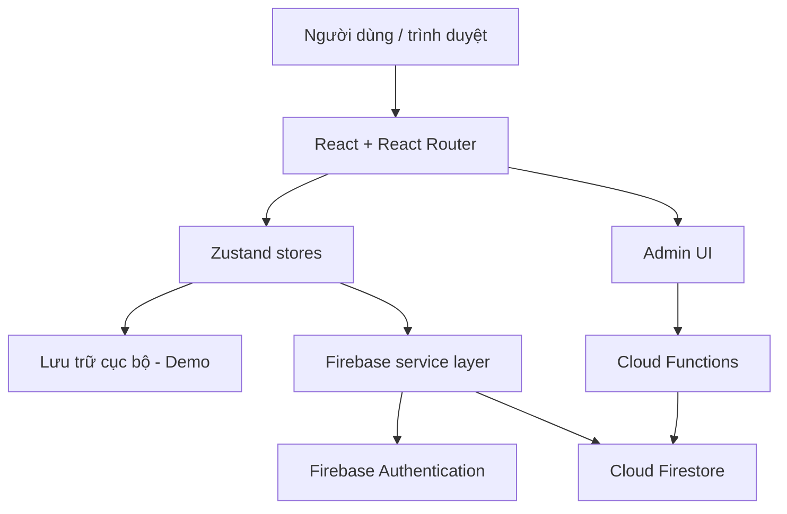

<div align="center">
  

  <h1>VanTien Study</h1>

  <h3>StudyFlow Pro · Không gian quản lý học tập thông minh</h3>

  <p><strong>Thời khóa biểu · Công việc · Tập trung · Thói quen · Phân tích tiến độ</strong></p>

  <p>
    
    
    
    
  </p>

  <p>
    <a href="#bat-dau-nhanh"><strong>🚀 Bắt đầu nhanh</strong></a> ·
    <a href="#tinh-nang"><strong>✨ Tính năng</strong></a> ·
    <a href="#kien-truc"><strong>🏗️ Kiến trúc</strong></a> ·
    <a href="#cau-hinh-firebase"><strong>⚙️ Firebase</strong></a> ·
    <a href="#trien-khai"><strong>🌐 Triển khai</strong></a>
  </p>
</div>

---

<div align="center">
  
  <p><sub>Hình minh họa có sẵn trong mã nguồn — không phải ảnh chụp màn hình ứng dụng.</sub></p>
</div>

> [!IMPORTANT]
> **Cấu trúc chuẩn:** `README.md`, `package.json`, `src/` và `public/` nằm ngay tại thư mục gốc repository. Sau khi clone, hãy chạy `npm` tại thư mục này.
>
> **Trạng thái:** dự án phục vụ phát triển và thử nghiệm. Các luồng Firebase, xác thực quản trị và khả năng chạy trên thiết bị thật cần được kiểm thử trước khi sử dụng production.

<a id="tong-quan"></a>
## 📖 Tổng quan

**VanTien Study / StudyFlow Pro** là ứng dụng web hỗ trợ sắp xếp lịch học và công việc hằng ngày trong một không gian thống nhất. Dự án được xây dựng bằng **React + TypeScript + Vite**, sử dụng **Zustand** để quản lý trạng thái và **Firebase** cho các tính năng có tài khoản/đồng bộ dữ liệu.

Ứng dụng có chế độ **trải nghiệm Demo** với dữ liệu cục bộ và chế độ **tài khoản Firebase** khi đã cấu hình. Dữ liệu Demo không được xem là dữ liệu đồng bộ đa thiết bị.

<a id="tinh-nang"></a>
## ✨ Tính năng

| Phân hệ | Mô tả | Vị trí trong mã nguồn |
|:---|:---|:---|
| 🏠 **Dashboard** | Tổng quan ngày học và tiến độ cá nhân | `src/features/dashboard/` |
| 📅 **Calendar** | Tổ chức lịch học, lịch ngày/tuần/tháng | `src/features/calendar/` |
| ✅ **Tasks** | Nhiệm vụ, trạng thái và checklist công việc | `src/features/tasks/` |
| 🔄 **Backlog** | Sắp xếp lại kế hoạch, công việc tồn đọng | `src/features/reschedule/` |
| ⏱️ **Focus Studio** | Phiên tập trung, Pomodoro và đồng hồ | `src/features/focus/` |
| 📊 **Analytics** | Thống kê học tập và tiến độ | `src/features/analytics/` |
| 🧭 **Roadmap** | Kế hoạch và lộ trình học tập | `src/features/roadmap/` |
| 🌱 **Habits** | Theo dõi thói quen | `src/features/habits/` |
| 📓 **Journal** | Ghi chép và nhật ký học tập | `src/features/journal/` |
| 🔔 **Reminders** | Nhắc việc theo khả năng của trình duyệt | `src/features/reminders/` |
| 👤 **Authentication** | Đăng nhập, đăng ký, quản lý phiên | `src/features/auth/` |
| 🛡️ **Admin** | Giao diện quản trị và một số tác vụ Firebase Functions | `src/features/admin/` |

**Đường dẫn giao diện:** `/`, `/today`, `/calendar`, `/tasks`, `/backlog`, `/focus`, `/analytics`, `/roadmap`, `/habits`, `/journal`, `/settings`, `/login`, `/register`, `/reviews`, `/admin/login`, `/admin`.

<a id="bat-dau-nhanh"></a>
## 🚀 Bắt đầu nhanh

### Yêu cầu

- **Node.js LTS** tương thích với Vite 8 (khuyến nghị Node.js 24 LTS).
- **npm** đi kèm Node.js.
- **Git** và **VS Code** (khuyến nghị).
- Tài khoản Firebase chỉ cần nếu muốn sử dụng dữ liệu trực tuyến hoặc triển khai lên Firebase.

### Bước 1 — Tải mã nguồn (sau khi đã đưa ZIP lên GitHub)

Mở **PowerShell** hoặc **Terminal** trong VS Code:

```powershell
git clone https://github.com/luu246luu-del/ThoiKhoaBieu.git
cd .\ThoiKhoaBieu
```

Nếu đã đặt mã nguồn tại `D:\WedTKB` **và** tại đó có `package.json`, dùng:

```powershell
cd D:\WedTKB
```

### Bước 2 — Cài thư viện

```powershell
npm ci
```

Lệnh này cài dependencies theo `package-lock.json`. **Không tải `node_modules/` lên GitHub.**

### Bước 3 — Chạy ứng dụng

```powershell
npm run dev
```

Mở địa chỉ Vite hiển thị trong Terminal, mặc định là **http://localhost:5173/**.

> [!TIP]
> Có thể trải nghiệm một số tính năng bằng chế độ Demo khi chưa cấu hình Firebase thật. Chế độ này không đại diện cho cơ chế phân quyền và đồng bộ production.

<a id="kien-truc"></a>
## 🏗️ Công nghệ & kiến trúc

| Lớp hệ thống | Công nghệ / thành phần |
|---|---|
| Giao diện | React 19, TypeScript 6, Vite 8 |
| Styling / UI | Tailwind CSS, Radix UI, Lucide React |
| Điều hướng | React Router |
| Quản lý trạng thái | Zustand |
| Đăng nhập | Firebase Authentication |
| Dữ liệu người dùng | Cloud Firestore |
| Tác vụ quản trị | Cloud Functions (Node.js 22) |
| Triển khai giao diện | Firebase Hosting |
| Trải nghiệm PWA | Web app manifest và service worker có sẵn |
| Kiểm thử mã nguồn | TypeScript tests qua `tsx`, Oxlint |



Sơ đồ trên phản ánh các thành phần logic trong mã nguồn, không có nghĩa mọi kết nối đã được kiểm thử trên production.

### Cấu trúc repository

```text
ThoiKhoaBieu/
├── README.md                 # Trang chủ GitHub (file này)
├── docs/
│   └── DEVELOPMENT.md       # Tài liệu kỹ thuật chuyên sâu
├── src/
│   ├── components/          # UI, layout, route protection
│   ├── features/            # Calendar, Tasks, Focus, Analytics, Admin...
│   ├── services/firebase/   # Tích hợp Firebase
│   ├── stores/              # Zustand state management
│   └── tests/               # Bộ kiểm thử
├── public/                  # Icon, manifest, service worker
├── functions/               # Firebase Cloud Functions
├── admin-tools/             # Tiện ích quản trị cục bộ
├── firestore.rules
├── firestore.indexes.json
├── firebase.json
├── .env.example             # Mẫu cấu hình, không chứa dữ liệu thật
├── .gitignore
├── package.json
└── package-lock.json
```

**Tài liệu kỹ thuật chi tiết:** [docs/DEVELOPMENT.md](./docs/DEVELOPMENT.md).

<a id="cau-hinh-firebase"></a>
## ⚙️ Cấu hình Firebase

### 1. Tạo dự án Firebase

1. Vào [Firebase Console](https://console.firebase.google.com/), tạo hoặc chọn một Firebase project.
2. Đăng ký một **Web App** để lấy cấu hình web.
3. Bật **Authentication** và phương thức đăng nhập phù hợp với ứng dụng.
4. Tạo **Cloud Firestore**; rà soát Rules trước khi nhập dữ liệu thật.
5. Trong thư mục gốc dự án, sao chép `.env.example` thành `.env.local`.

```powershell
Copy-Item .env.example .env.local
```

### 2. Cập nhật biến môi trường

Mở `.env.local` và điền các thông số từ Firebase Console:

```dotenv
VITE_FIREBASE_API_KEY=your_api_key_here
VITE_FIREBASE_AUTH_DOMAIN=your-project-id.firebaseapp.com
VITE_FIREBASE_PROJECT_ID=your-project-id
VITE_FIREBASE_STORAGE_BUCKET=your-project-id.firebasestorage.app
VITE_FIREBASE_MESSAGING_SENDER_ID=your_sender_id_here
VITE_FIREBASE_APP_ID=your_app_id_here
VITE_USE_FIREBASE_EMULATOR=false
VITE_ADMIN_LOGIN_EMAIL=admin@example.com
```

> [!CAUTION]
> Tuyệt đối không commit `.env.local`, khóa service account, khóa bí mật TOTP, mật khẩu hoặc token lên GitHub. Các biến `VITE_*` **được nhúng vào frontend build** nên cũng không được sử dụng làm nơi cất bí mật. Firebase Web API Key không thay thế việc bảo vệ dữ liệu bằng Authentication và Firestore Security Rules.

### 3. Chạy Firebase Emulator (tùy chọn)

Cài Firebase CLI và đăng nhập:

```powershell
npm install -g firebase-tools
firebase login
```

Khởi chạy các dịch vụ giả lập được cấu hình trong `firebase.json`:

```powershell
firebase emulators:start --only auth,firestore
```

Đổi `VITE_USE_FIREBASE_EMULATOR=true` trong `.env.local` nếu muốn frontend kết nối Emulator, sau đó khởi động lại `npm run dev`.

**Cổng cấu hình:** Authentication `9099`, Firestore `8080`, Emulator UI `4000` (khi khởi động đầy đủ các Emulator). Chỉ dùng Emulator cho môi trường phát triển.

## 🧪 Lệnh phát triển & kiểm thử

Chạy các lệnh bên dưới **trong thư mục gốc repository (nơi có `package.json`)**.

| Lệnh | Chức năng |
|---|---|
| `npm run dev` | Chạy Vite ở chế độ phát triển |
| `npm run build` | Kiểm tra TypeScript và build production vào `dist/` |
| `npm run preview` | Xem bản build production trên máy |
| `npm run lint` | Chạy Oxlint |
| `npm test` | Chạy các test hiện có qua `tsx` |

Khuyến nghị kiểm tra trước mỗi lần đẩy code:

```powershell
npm run lint
npm test
npm run build
```

Nếu một bước lỗi, xem thông báo Terminal và xử lý trước khi deploy.

<a id="trien-khai"></a>
## 🌐 Triển khai Firebase Hosting

> [!WARNING]
> Chỉ triển khai khi đã cấu hình Firebase project, Rules, quyền quản trị và xác thực đúng. Repository này không cung cấp chứng nhận production-ready.

1. Trong thư mục gốc repository, tạo build:

```powershell
npm ci
npm run build
```

2. Đăng nhập Firebase CLI và chọn dự án:

```powershell
firebase login
firebase use --add
```

3. File `firebase.json` dùng **Hosting target** có tên `vantien`. Cần ánh xạ target tới Firebase Hosting site ID thực tế **trước khi deploy**:

```powershell
firebase target:apply hosting vantien YOUR_HOSTING_SITE_ID
firebase deploy --only hosting:vantien
```

4. Nếu cần triển khai Firestore Rules/Indexes, hãy đọc và kiểm tra kỹ rồi mới chạy:

```powershell
firebase deploy --only firestore
```

**Cloud Functions:** nằm tại `functions/`, sử dụng Node.js 22 theo cấu hình package. Việc deploy Functions có thể yêu cầu bật billing và phân quyền bổ sung. Các tác vụ bootstrap quyền admin/TOTP cần được kiểm tra riêng; không đưa khóa TOTP hay thông tin chủ sở hữu vào mã nguồn công khai.

## 🔐 Bảo mật & quyền riêng tư

- Firebase Authentication và **Firestore Security Rules** phải được kiểm tra cùng nhau; chặn route trên frontend **không** phải kiểm soát truy cập đủ mạnh.
- Không đưa lên GitHub: `.env.local`, `node_modules/`, `dist/`, dữ liệu cá nhân, file sao lưu, khóa service account hoặc secrets.
- Không lưu thông tin đăng nhập hay khóa TOTP trong README, mã JavaScript frontend hoặc commit history.
- Thử nghiệm trên Firebase Emulator trước khi dùng dữ liệu thật.
- Dữ liệu demo lưu trên thiết bị/trình duyệt có thể mất khi xóa dữ liệu trình duyệt và không tự đồng bộ.
- Cấu hình giới hạn quyền đọc/ghi, sao lưu và quy trình xóa dữ liệu trước khi mở rộng cho người dùng thật.

## 🛠️ Xử lý lỗi thường gặp

<details>
<summary><strong>npm ERR! enoent: không tìm thấy package.json</strong></summary>

Hãy mở thư mục gốc repository `ThoiKhoaBieu` (nơi chứa `package.json`), rồi chạy `npm ci`.

</details>

<details>
<summary><strong>Không chạy được npm hoặc phiên bản Node.js không tương thích</strong></summary>

Kiểm tra `node -v`, `npm -v`; cài Node.js LTS tương thích và mở Terminal mới. Chạy lại `npm ci`.

</details>

<details>
<summary><strong>Ứng dụng mở được nhưng không đăng nhập Firebase</strong></summary>

Kiểm tra `.env.local`, Firebase Authentication, cấu hình Web App, allowed domains và Firestore Rules. Khởi động lại Vite sau khi sửa `.env.local`.

</details>

<details>
<summary><strong>Firebase Hosting báo target vantien không tồn tại</strong></summary>

Dùng `firebase target:apply hosting vantien YOUR_HOSTING_SITE_ID` sau khi chọn đúng Firebase project.

</details>

<details>
<summary><strong>README trên GitHub không đẹp hoặc không giống VS Code</strong></summary>

Trang chủ GitHub lấy `README.md` **ở thư mục gốc**. Repository này có thêm `docs/DEVELOPMENT.md` là tài liệu kỹ thuật riêng. Muốn sửa giao diện trang chủ, phải cập nhật file gốc `ThoiKhoaBieu/README.md`, commit và push.

</details>

## 🤝 Phát triển & đóng góp

1. Tạo nhánh cho từng chức năng hoặc bản sửa lỗi.
2. Chỉ commit mã nguồn và cấu hình **không chứa bí mật**.
3. Chạy `npm run lint`, `npm test`, `npm run build`.
4. Tạo Pull Request kèm mô tả thay đổi, ảnh chụp nếu sửa giao diện và cách kiểm thử.

## 📌 Trạng thái dự án

| Hạng mục | Ghi chú |
|---|---|
| Mã nguồn | Có trong repository này |
| React / Vite | Cấu hình có sẵn |
| Firebase Auth / Firestore | Có mã tích hợp; cần cấu hình và kiểm thử |
| Firebase Hosting | Có cấu hình target; cần ánh xạ Hosting site |
| Cloud Functions | Có source; chưa khẳng định triển khai production |
| Kiểm thử production | Chưa được xác nhận |

---

<div align="center">
  <strong>VanTien Study — Học có kế hoạch, tiến bộ có hệ thống.</strong>
  <br />
  <sub>Made with React, TypeScript and Firebase · <a href="./src/">Khám phá mã nguồn</a></sub>
</div>
