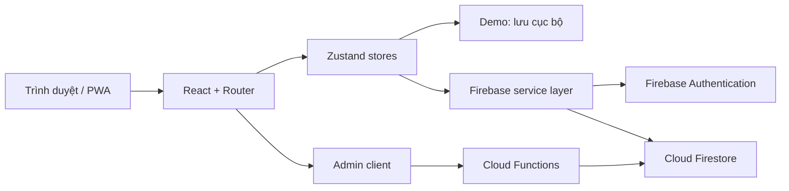

> [!NOTE]
> Đây là tài liệu kỹ thuật đi kèm. Mọi lệnh `npm` / `firebase` đều chạy tại **thư mục gốc repository `ThoiKhoaBieu/`** (nơi có `package.json`). Xem [README trang chủ](../README.md) nếu mới bắt đầu.

# VanTien Study / StudyFlow Pro

> Ứng dụng quản lý học tập và thời khóa biểu viết bằng **React + TypeScript + Vite**, tích hợp **Firebase Authentication, Cloud Firestore, Firebase Hosting** và một số tác vụ quản trị qua **Cloud Functions**.
>
> **Trạng thái:** mã nguồn phục vụ phát triển và thử nghiệm. Chưa được chứng nhận hoặc kiểm thử đầy đủ trên Firebase production, trên mọi trình duyệt hay thiết bị di động.

## Mục lục

1. [Tổng quan](#1-tổng-quan)
2. [Tính năng hiện có](#2-tính-năng-hiện-có)
3. [Công nghệ và kiến trúc](#3-công-nghệ-và-kiến-trúc)
4. [Cấu trúc thư mục](#4-cấu-trúc-thư-mục)
5. [Cài đặt trên Windows và chạy thử](#5-cài-đặt-trên-windows-và-chạy-thử)
6. [Cấu hình Firebase](#6-cấu-hình-firebase)
7. [Các lệnh phát triển và kiểm thử](#7-các-lệnh-phát-triển-và-kiểm-thử)
8. [Triển khai Firebase Hosting và Firestore](#8-triển-khai-firebase-hosting-và-firestore)
9. [Quản trị, Cloud Functions và TOTP](#9-quản-trị-cloud-functions-và-totp)
10. [Luồng dữ liệu](#10-luồng-dữ-liệu)
11. [Quyền riêng tư và lưu ý bảo mật](#11-quyền-riêng-tư-và-lưu-ý-bảo-mật)
12. [Giới hạn đã biết](#12-giới-hạn-đã-biết)
13. [Sự cố thường gặp](#13-sự-cố-thường-gặp)
14. [Đưa dự án lên GitHub](#14-đưa-dự-án-lên-github)
15. [Checklist nghiệm thu](#15-checklist-nghiệm-thu)

---

## 1. Tổng quan

**VanTien Study** (tên gói npm: `studyflow-pro`) là ứng dụng web hỗ trợ quản lý lịch học, công việc cá nhân và thời gian tập trung. Dự án sử dụng thiết kế responsive và hỗ trợ trải nghiệm PWA ở mức lưu cache giao diện.

Ứng dụng có hai chế độ sử dụng:

- **Demo/khách:** trải nghiệm chức năng với dữ liệu cục bộ trong trình duyệt, không cần Firebase thật. Dữ liệu này không được đồng bộ lên nhiều thiết bị.
- **Tài khoản Firebase:** đăng ký/đăng nhập và lưu trữ dữ liệu qua Firebase Authentication/Firestore nếu cấu hình, phân quyền và Rules hợp lệ.

> **Lưu ý về tên repository:** repository GitHub có thể đặt tên `ThoiKhoaBieu`, còn package bên trong dự án là `studyflow-pro`; đây không phải hai ứng dụng khác nhau.

## 2. Tính năng hiện có

| Phân hệ | Mô tả |
| --- | --- |
| Dashboard | Tổng hợp các hoạt động học tập, công việc và các chỉ số cá nhân |
| Hôm nay (Today) | Xem công việc và lịch trong ngày |
| Calendar | Lịch ngày/tuần/tháng, tạo/sửa lịch và kéo thả theo giao diện desktop |
| Tasks | Quản lý nhiệm vụ, checklist và trạng thái hoàn thành |
| Backlog / Reschedule | Chuyển lịch công việc, kiểm tra xung đột thời gian, chia phiên |
| Focus Studio | Pomodoro, countdown, stopwatch, đồng hồ, lưu phiên tập trung |
| Analytics | Thống kê phiên học, thời gian tập trung, tiến độ công việc |
| Roadmap | Kế hoạch học tập và checklist lộ trình được định nghĩa trong ứng dụng |
| Habits | Theo dõi thói quen và nhật ký thực hiện |
| Journal | Ghi chú/nhật ký học tập |
| Reminders | Thông báo khi web còn hoạt động, hỗ trợ browser notification khi được cấp quyền |
| Settings | Tùy chỉnh giao diện và các thiết lập người dùng |
| Reviews | Trang đánh giá công khai của ứng dụng |
| Admin | Giao diện quản trị, tích hợp logic phân quyền và một số tác vụ qua Cloud Functions |

Một số tính năng vẫn cần xác minh bằng kiểm thử thiết bị thật hoặc Firebase Emulator. Có mã nguồn tính năng không đồng nghĩa tất cả luồng đã đạt chuẩn production.

### Các đường dẫn chính

`/` (Dashboard), `/today`, `/calendar`, `/tasks`, `/backlog`, `/focus`, `/analytics`, `/roadmap`, `/habits`, `/journal`, `/settings`, `/login`, `/register`, `/reviews`, `/admin/login`, `/admin`.

Các trang yêu cầu tài khoản được bảo vệ bằng logic route trong `src/components/layout/protected-route.tsx`. Không xem việc bảo vệ UI là thay thế cho Firestore Rules và xác thực trên server.

## 3. Công nghệ và kiến trúc

| Lớp | Công nghệ |
| --- | --- |
| UI | React 19, TypeScript, Vite 8 |
| Styling | Tailwind CSS, Radix UI, Lucide Icons |
| Routing | React Router |
| State | Zustand |
| Authentication | Firebase Authentication |
| Database đồng bộ | Cloud Firestore |
| Backend tùy chọn | Firebase Cloud Functions v2, Node.js 22 |
| Hosting | Firebase Hosting |
| PWA | `public/manifest.json`, `public/sw.js` |
| Test | Script kiểm thử TypeScript (`tsx`) và các bài test hiện có trong `src/tests` |



Đây là sơ đồ logic ở mức tổng quan, không phải cam kết về triển khai tất cả dịch vụ trong môi trường thật.

## 4. Cấu trúc thư mục

```text

├── src/
│   ├── components/
│   │   ├── layout/          # Bố cục, menu, bảo vệ route
│   │   └── ui/              # Thành phần giao diện dùng chung
│   ├── data/                # Dữ liệu mẫu/định nghĩa lộ trình
│   ├── features/            # Admin, Auth, Calendar, Tasks, Focus, ...
│   ├── lib/                 # Hàm thời gian, lưu trữ, tiện ích
│   ├── routes/              # Khai báo đường dẫn
│   ├── services/firebase/   # Firebase Auth, Firestore, admin, reviews
│   ├── stores/              # Zustand state
│   ├── styles/              # CSS và giao diện
│   ├── tests/               # Kiểm thử hiện có
│   ├── types/               # Kiểu dữ liệu TypeScript
│   └── main.tsx             # Điểm vào ứng dụng
├── public/                  # Icon, PWA manifest, service worker
├── functions/               # Cloud Functions, cấu hình npm riêng
├── admin-tools/             # Công cụ tạo khóa TOTP cục bộ
├── firestore.rules          # Quy tắc bảo mật Firestore
├── firestore.indexes.json  # Index Firestore
├── firebase.json            # Hosting, Firestore, Emulator, Functions
├── .env.example             # Mẫu biến môi trường không chứa thông tin thực
├── .gitignore               # File/thư mục không đưa lên Git
├── package.json
├── package-lock.json
└── README.md
```

**Không có sẵn `node_modules/`, `dist/`, `.env.local` hoặc dữ liệu sao lưu trong bản GitHub sạch.** Đây là chủ ý để bảo vệ dữ liệu và giảm dung lượng repository.

## 5. Cài đặt trên Windows và chạy thử

### 5.1. Phần mềm cần có

- Windows 10/11; VS Code (khuyến nghị).
- Node.js bản LTS mới phù hợp với lockfile (khuyến nghị **Node.js 24 LTS**); npm đi kèm.
- Git để quản lý mã nguồn.
- Nếu sử dụng Firebase: tài khoản Firebase và Firebase CLI.

Kiểm tra trong **Terminal → New Terminal** của VS Code:

```powershell
node -v
npm -v
git --version
```

### 5.2. Mở đúng thư mục

Giải nén file ZIP sạch, mở thư mục **`ThoiKhoaBieu`**, tức thư mục có file `package.json`. Trong VS Code có thể chọn **File → Open Folder…**.

Nếu Terminal đang ở `D:\WedTKB` và đã đặt thư mục dự án bên trong đó:

```powershell
cd D:\WedTKB
```

### 5.3. Cài dependencies

```powershell
npm ci
```

`npm ci` đọc `package-lock.json` và cài lại thư viện phù hợp với máy Windows đang chạy. Không tải `node_modules` từ một máy khác lên GitHub.

### 5.4. Khởi chạy giao diện

```powershell
npm run dev
```

Mở địa chỉ được in trong Terminal (thường là `http://localhost:5173/`). Nếu chưa cấu hình Firebase thật, chọn **Demo** tại trang đăng nhập để thử các luồng cục bộ được ứng dụng hỗ trợ.

## 6. Cấu hình Firebase

### 6.1. Tạo Firebase Project

1. Truy cập [Firebase Console](https://console.firebase.google.com/), tạo hoặc chọn project của **chính bạn**.
2. Tạo **Web App** và sao chép cấu hình ứng dụng web.
3. Bật **Authentication** với các phương thức đăng nhập sẽ sử dụng (ví dụ Email/Password, Google nếu cần).
4. Tạo **Cloud Firestore** và chọn vùng dữ liệu phù hợp.
5. Thiết lập các **Authorized domains** cho Firebase Authentication đúng môi trường truy cập.
6. Kiểm tra quy tắc bảo mật và index trước khi dùng dữ liệu thật.

### 6.2. Tạo `.env.local`

Trong thư mục gốc:

```powershell
Copy-Item .env.example .env.local
```

Sửa `.env.local` theo thông tin từ Firebase Console:

```dotenv
VITE_FIREBASE_API_KEY=YOUR_FIREBASE_WEB_API_KEY
VITE_FIREBASE_AUTH_DOMAIN=YOUR_PROJECT_ID.firebaseapp.com
VITE_FIREBASE_PROJECT_ID=YOUR_PROJECT_ID
VITE_FIREBASE_STORAGE_BUCKET=YOUR_PROJECT_ID.firebasestorage.app
VITE_FIREBASE_MESSAGING_SENDER_ID=YOUR_SENDER_ID
VITE_FIREBASE_APP_ID=YOUR_FIREBASE_WEB_APP_ID
VITE_USE_FIREBASE_EMULATOR=false
VITE_ADMIN_LOGIN_EMAIL=admin@example.com
```

Giá trị trên là **minh họa**, không phải thông tin Firebase thực tế. Hãy sao chép nguyên giá trị tương ứng từ Firebase Console; `storageBucket` có thể khác tùy project cũ/mới.

**Quan trọng:** `VITE_*` sẽ được đưa vào mã frontend khi build, **không phải nơi chứa khóa bí mật**. Không lưu mật khẩu admin, service-account private key, TOTP secret hoặc token đặc quyền dưới tiền tố `VITE_`.

Biến `VITE_ADMIN_LOGIN_EMAIL` trong dự án hiện tại dùng để chuyển tên đăng nhập đặc biệt `admin` thành email Firebase của chủ sở hữu. Địa chỉ này xuất hiện trong mã web khi build; đừng coi đây là một bí mật hay là cơ chế cấp quyền. Quyền thực tế phải kiểm tra qua Firebase token, Rules và server.

### 6.3. Firebase Emulator (khuyến nghị trước khi deploy)

```powershell
npm install -g firebase-tools
firebase login
firebase emulators:start
```

Chạy ứng dụng Vite trong Terminal khác; đặt `VITE_USE_FIREBASE_EMULATOR=true` trong `.env.local` **chỉ khi dùng emulator** và khởi động lại `npm run dev`.

Cấu hình mặc định đọc từ `firebase.json`: Authentication 9099, Firestore 8080, Hosting 5000, Emulator UI 4000. Hãy chắc chắn không có ứng dụng khác chiếm cổng và không nhập dữ liệu cá nhân thực vào môi trường kiểm thử công khai.

## 7. Các lệnh phát triển và kiểm thử

| Lệnh | Công dụng |
| --- | --- |
| `npm ci` | Cài chính xác dependencies theo lockfile |
| `npm run dev` | Chạy Vite dev server |
| `npm run build` | Kiểm tra TypeScript (`tsc --noEmit`) rồi tạo bản build trong `dist/` |
| `npm run preview` | Xem bản build production trên máy cục bộ |
| `npm run lint` | Chạy oxlint |
| `npm run test` | Chạy các test hiện có trong `src/tests/run.ts` |

Chạy chuỗi kiểm thử trước khi commit hoặc deploy:

```powershell
npm ci
npm run lint
npm run test
npm run build
```

> **Trạng thái kiểm thử:** Tài liệu này được viết sau khi kiểm tra cấu trúc mã nguồn trong gói được cung cấp. Các lệnh phía trên là **hướng dẫn cần chạy** trên máy của bạn; không khẳng định bộ mã đã vượt qua kiểm thử/build hoặc triển khai Firebase production trong lần chuẩn bị gói GitHub này.

## 8. Triển khai Firebase Hosting và Firestore

### 8.1. Liên kết project

```powershell
npm install -g firebase-tools
firebase login
firebase use --add
```

Vì `.firebaserc` chứa liên kết project/hosting tại máy cá nhân nên đã được **loại khỏi bản công khai**. `firebase use --add` sẽ tạo/cập nhật lại liên kết cho project của bạn.

### 8.2. Hosting target

Trong `firebase.json`, dự án dùng hosting target `vantien`. Trước lần deploy Hosting đầu tiên, liên kết target với **Hosting site ID thực tế** của bạn:

```powershell
firebase target:apply hosting vantien YOUR_HOSTING_SITE_ID
```

Sau đó thử build và deploy theo thứ tự:

```powershell
npm run build
firebase deploy --only firestore:rules,firestore:indexes
firebase deploy --only hosting
```

Chỉ triển khai khi bạn có quyền với project Firebase và đã kiểm thử Firestore Rules. **Không sao chép cấu hình production của người khác để deploy.** Nếu Firebase yêu cầu cập nhật billing để dùng dịch vụ, hãy xem xét trước khi đồng ý.

## 9. Quản trị, Cloud Functions và TOTP

Dự án có `functions/index.cjs` triển khai chức năng quản trị trên server. Theo mã nguồn, các kiểm tra quan trọng kết hợp:

- Firebase Authentication UID của chủ sở hữu.
- Firebase **custom claims** cho tài khoản admin/owner.
- Xác minh TOTP trên server; dữ liệu secret cấu hình qua Firebase Functions secrets.
- Phiên admin ngắn hạn; giới hạn và kiểm tra lại quyền ở server.

### Chuẩn bị Cloud Functions

Cloud Functions dùng package riêng tại `functions/package.json`, với engine **Node.js 22**.

```powershell
cd functions
npm ci
cd ..
```

Các bí mật mà server kỳ vọng gồm:

```powershell
firebase functions:secrets:set VANTIEN_OWNER_UID
firebase functions:secrets:set VANTIEN_ADMIN_TOTP_SEED
```

Tạo seed TOTP **chỉ trên máy cá nhân**, không gửi qua chat và không commit output vào Git:

```powershell
node admin-tools/generate-totp-key.cjs
```

Công cụ này sẽ in khóa TOTP để bạn cấu hình ứng dụng Authenticator và Firebase Secret Manager. **Không đưa khóa hoặc URI `otpauth://` lên GitHub.**

Script `functions/bootstrap-owner.cjs` là thủ tục tạo quyền owner một lần và **có kiểm tra mã project Firebase cố định trong mã nguồn**. Trước khi sử dụng, người vận hành phải đọc script, xác minh project đích, Application Default Credentials và UID chủ sở hữu; **không chạy tùy tiện trên dữ liệu thật**. Tạo tài khoản chủ sở hữu bằng email khôi phục thật trước khi thực hiện bootstrap.

Cloud Functions v2 có thể yêu cầu dự án Firebase/GCP có thiết lập billing thích hợp. Chỉ thực hiện deployment khi đã có quyền và đồng ý với chi phí có thể phát sinh:

```powershell
firebase deploy --only functions:admin
```

Nếu bạn chưa thiết lập tài khoản owner hoặc các secret, các tính năng quản trị nâng cao có thể không hoạt động. Trang `/admin` tồn tại trong mã nguồn không tự động có nghĩa là đã cấu hình được quyền truy cập.

## 10. Luồng dữ liệu

### Đăng ký và đăng nhập

- Đăng nhập username/password sử dụng Firebase Auth khi đã cấu hình.
- Username thường được ánh xạ sang địa chỉ nội bộ dạng `username@studyflow.internal` và không phải email nhận thư thật.
- Đăng nhập Google có trong lớp dịch vụ ứng dụng; cần cấu hình phương thức Google tại Firebase Console.
- Chế độ Demo dùng dữ liệu trình duyệt và không bảo đảm khả năng đồng bộ.

### Nhiệm vụ, lịch học và Focus

- `src/stores/data-store.ts` là điểm quản lý state tác vụ/lịch/phiên học.
- `src/services/firebase/firestore-service.ts` xử lý giao tiếp với Firestore.
- `src/lib/schedule.ts` có logic thời gian và ngày địa phương theo múi giờ Việt Nam.
- `src/lib/focus-time.ts` hỗ trợ xử lý thời gian phiên Focus.
- Thống kê nên được hiểu là thống kê từ bản ghi người dùng đã lưu, không suy diễn tự động rằng người dùng đã học chỉ vì có lịch trong thời khóa biểu.

### Quy ước dữ liệu

- Nhiệm vụ (Task), lịch xếp thời gian và phiên tập trung (Focus Session) là các khái niệm khác nhau.
- Chuyển lịch không đồng nghĩa đánh dấu đã hoàn thành.
- Các phép cập nhật nhiều bản ghi liên quan cần được kiểm tra tính nhất quán trong Firestore transaction/batch.
- Khi import sao lưu JSON, dữ liệu cùng ID có thể bị cập nhật; nên export sao lưu trước khi import.

## 11. Quyền riêng tư và lưu ý bảo mật

Repository này có thể là **public**. Trước mỗi lần commit, hãy kiểm tra:

- [ ] Không có `.env.local`, `.env`, service-account JSON, Firebase Admin private key hay tài khoản/mật khẩu thật.
- [ ] Không đưa `node_modules`, `dist`, `.firebase`, dữ liệu sao lưu cá nhân hoặc các bản ZIP lớn vào repository.
- [ ] Không commit TOTP seed/Authenticator setup URI/secret của Firebase Functions.
- [ ] Không dùng `VITE_*` để lưu bí mật máy chủ; các biến này hiện diện trong frontend build.
- [ ] Firestore Rules được kiểm thử với ít nhất hai tài khoản không cùng quyền.
- [ ] Đã xem xét việc hiển thị Firebase project ID và email owner trên mã nguồn public; đây là định danh, không phải lớp bảo mật.
- [ ] Không nhầm trang `/admin` với quyền admin đã được server xác minh.

`.gitignore` trong bản sạch chỉ giảm nguy cơ commit nhầm. **Nếu đã commit secret trước đó thì việc thêm `.gitignore` không xóa secret khỏi lịch sử Git; cần thu hồi/rotate secret và xử lý lịch sử phù hợp.**

## 12. Giới hạn đã biết

1. **Không bảo đảm thông báo nền** khi đóng trình duyệt hoặc khóa điện thoại: phần nhắc việc hiện có hoạt động khi trang web/PWA còn chạy; chưa có cơ chế Web Push server đầy đủ được kiểm chứng.
2. **Chế độ Demo không đồng bộ cloud** và không được xem là tài khoản thật.
3. Username sử dụng email nội bộ không cung cấp hộp thư nhận email khôi phục mặc định; phải xây dựng thêm quy trình khôi phục phù hợp cho người dùng thật.
4. Lịch lặp hiện tại dùng các sự kiện được tạo trong một khoảng giới hạn, chưa phải recurrence engine đầy đủ với ngoại lệ cho chuỗi vô hạn.
5. Thao tác kéo thả lịch trên thiết bị cảm ứng chưa được khẳng định đã tối ưu trên mọi điện thoại.
6. Thống kê, roadmap, đánh giá và các biểu đồ cần kiểm thử end-to-end nếu sử dụng trong sản phẩm công khai.
7. Các Firestore Rules và admin Functions chưa được kiểm thử production như một phần của việc làm sạch ZIP này.
8. Không phải ứng dụng điểm danh vân tay: repository này là **StudyFlow/ThoiKhoaBieu**; mã nguồn ESP32 và cảm biến không nằm trong gói.

## 13. Sự cố thường gặp

**`npm.ps1 cannot be loaded` trong PowerShell**  
Trong VS Code, chọn **Terminal → Select Default Profile → Command Prompt**, mở Terminal mới và chạy `npm ci`. Không cần tắt chính sách bảo mật của Windows.

**`node` / `npm` không được nhận diện**  
Cài Node.js LTS, đóng/mở lại Terminal, chạy `node -v`.

**`npm ci` thất bại**  
Đảm bảo đang ở thư mục có `package.json` và `package-lock.json`; kiểm tra Node.js, mạng và thông báo lỗi cụ thể. Không xóa lockfile để né lỗi một cách tùy tiện.

**Màn hình trống hoặc không đăng nhập được**  
Mở DevTools (F12) → Console; kiểm tra `.env.local`, Firebase Console, phương thức đăng nhập, Authorized domains và Firestore Rules.

**`Missing or insufficient permissions`**  
Kiểm tra tài khoản đang đăng nhập, quy tắc `firestore.rules` và dữ liệu sở hữu theo UID. Không sửa Rules thành `allow read, write: if true` để chạy tạm trên production.

**`No currently active project` khi deploy**  
Chạy `firebase use --add` và chọn đúng Firebase project của bạn.

**Hosting target `vantien` không tồn tại**  
Chạy `firebase target:apply hosting vantien YOUR_HOSTING_SITE_ID` và kiểm tra site ID.

**Firebase Functions hoặc TOTP báo lỗi**  
Kiểm tra billing/quyền Functions, secret đã được tạo, owner UID, custom claims và trạng thái deploy. Không paste khóa TOTP hoặc credential vào issue công khai.

## 14. Đưa dự án lên GitHub

**Cách được khuyến nghị: dùng Git trong Terminal, không kéo 27.000 file lên giao diện web.**

Mở **thư mục `ThoiKhoaBieu`** sau khi giải nén, rồi chạy:

```powershell
git init
git branch -M main
git remote add origin https://github.com/luu246luu-del/ThoiKhoaBieu.git
git add .
git status
git commit -m "Initial commit: StudyFlow Pro source and documentation"
git push -u origin main
```

**Quan trọng:** Dùng GitHub account có quyền **Write** đối với repository. Nếu Git báo `remote origin already exists`, hãy kiểm tra bằng `git remote -v` và dùng `git remote set-url origin https://github.com/luu246luu-del/ThoiKhoaBieu.git` nếu đúng repository. Nếu nhánh `main` của GitHub đã có commit, cần `git fetch` rồi xem xét hợp nhất trước khi push; không dùng `--force` để ghi đè lịch sử khi chưa kiểm tra.

Sau khi push, truy cập:

- Mã nguồn: <https://github.com/luu246luu-del/ThoiKhoaBieu>
- README: <https://github.com/luu246luu-del/ThoiKhoaBieu/blob/main/README.md>

**Không upload nguyên file ZIP như một file trong repository** vì GitHub sẽ không tự giải nén thành cây mã nguồn. Nếu dùng trang *Upload files* trên GitHub, chỉ kéo thả những tệp mã nguồn đã lọc và chia nhỏ theo giới hạn của giao diện; dùng Git vẫn thuận tiện hơn.

## 15. Checklist nghiệm thu

- [ ] `npm ci` hoàn tất mà không có lỗi.
- [ ] `npm run lint` thành công.
- [ ] `npm run test` thành công.
- [ ] `npm run build` tạo được `dist/`.
- [ ] Giao diện Demo sử dụng được trên máy tính và điện thoại.
- [ ] Tạo tài khoản Firebase mới, đăng nhập lại và kiểm tra dữ liệu được đồng bộ.
- [ ] Một tài khoản không được đọc/sửa dữ liệu của tài khoản khác.
- [ ] Tạo công việc, dời lịch, hoàn thành và kiểm tra thống kê.
- [ ] Dùng Focus Studio, pause/resume, lưu phiên và kiểm tra số liệu.
- [ ] Kiểm tra nhập/xuất dữ liệu sao lưu với dữ liệu thử nghiệm.
- [ ] Firebase Hosting mở được các route trực tiếp sau khi refresh.
- [ ] Các lệnh Admin chỉ thành công với người có quyền và xác thực thứ hai hợp lệ.
- [ ] GitHub repository **không chứa** `.env.local`, `node_modules`, `dist` hoặc TOTP secret.

---

**Ghi chú:** README được xây dựng dựa trên cấu trúc và mã nguồn của file `ThoiKhoaBieu.zip` được cung cấp. Các phần cấu hình Firebase và GitHub là hướng dẫn thao tác; việc mã nguồn chạy thành công, triển khai thật và quyền truy cập GitHub phải được kiểm tra trên môi trường của chủ dự án.
